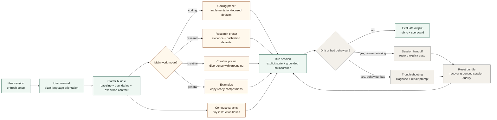

# Model Behaviour Toolkit

Modernized, provider-neutral prompt and interaction scaffolds for shaping model behaviour, restoring session quality, and reducing drift in real-world use.

This repo is being rebuilt from a collection of older GPT-era prompt/toolkit archives. The goal is to keep what still works, translate it into current model/agent workflows, and drop obsolete framing, duplicated artifacts, and era-specific quirks.

## Design Rules

- Plain language beats lore.
- Modules should work across providers and tool environments.
- Continuity should come from explicit state, not fake memory claims.
- Warmth is fine; anthropomorphic theater is not.
- Good defaults should reduce drift, not create a persona cult.

## Current Status

- Legacy audit: `docs/legacy-inventory.md`
- Core modules, compact variants, bundles, presets, examples, troubleshooting guides, and evaluation docs are now available

## Quick Start

1. If you are brand new, read `docs/user-manual.md`.
2. Use `bundles/starter-bundle.md` as the default starting point.
3. Use `compact/` if your platform has a tiny instruction box.
4. Add one preset from `presets/` if the work is mainly coding, research, or creative.
5. Jump to `examples/` if you want a finished copy-ready composition.
6. Use `troubleshooting/` when the assistant starts behaving badly.
7. Use `bundles/reset-bundle.md` when drift, context loss, or weird tone shows up.

## Toolkit Use Path

## First-Wave Modules

- `modules/baseline/session-baseline.md`
- `modules/baseline/boundary-aware-collaboration.md`
- `modules/recovery/session-restoration.md`
- `modules/recovery/portable-recovery.md`
- `modules/operator/session-handoff.md`
- `modules/operator/execution-contract.md`
- `modules/review/output-review-lens.md`
- `modules/exploration/creative-reframing.md`
- `docs/principles/non-anthropomorphic-collaboration.md`
- `docs/theory/context-continuity.md`

## Bundles

- `bundles/README.md`
- `bundles/starter-bundle.md`
- `bundles/reset-bundle.md`

## Presets

- `presets/coding.md`
- `presets/research.md`
- `presets/creative.md`

## Examples

- `examples/README.md`
- `examples/coding-project-kickoff.md`
- `examples/research-investigation.md`
- `examples/creative-ideation.md`

## Compact Variants

- `compact/README.md`
- `compact/general.md`
- `compact/reset.md`
- `compact/coding.md`
- `compact/research.md`
- `compact/creative.md`

## Troubleshooting

- `troubleshooting/README.md`
- `troubleshooting/diagnostic-flow.md`
- `troubleshooting/common-problems.md`
- `troubleshooting/anti-drift-recipes.md`

## Beginner Docs

- `docs/user-manual.md`
- [GLOSSARY.md](GLOSSARY.md)

## Contributor Docs

- `CONTRIBUTING.md`
- `docs/how-to-add-a-module.md`
- `docs/deprecation-policy.md`
- `docs/release-checklist.md`

## Release Docs

- `CHANGELOG.md`
- `docs/releases/README.md`
- `docs/releases/v0.1.0.md`

## Evaluation

- `evaluation/README.md`
- `evaluation/run-protocol.md`
- `evaluation/rubric.md`
- `evaluation/benchmark-tasks.md`
- `evaluation/scorecard-template.md`

## License

This repo is licensed under the GNU Affero General Public License v3.0.

See [LICENSE](LICENSE) for the full license text.

## What This Repo Is Becoming

Not a museum of named relics.

A small, practical toolkit for:

- starting sessions well
- restoring them when they drift
- carrying work across context boundaries
- making assistant initiative explicit
- keeping collaboration grounded and non-theatrical
